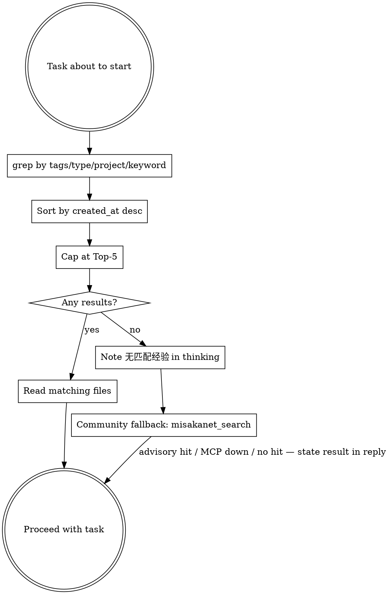
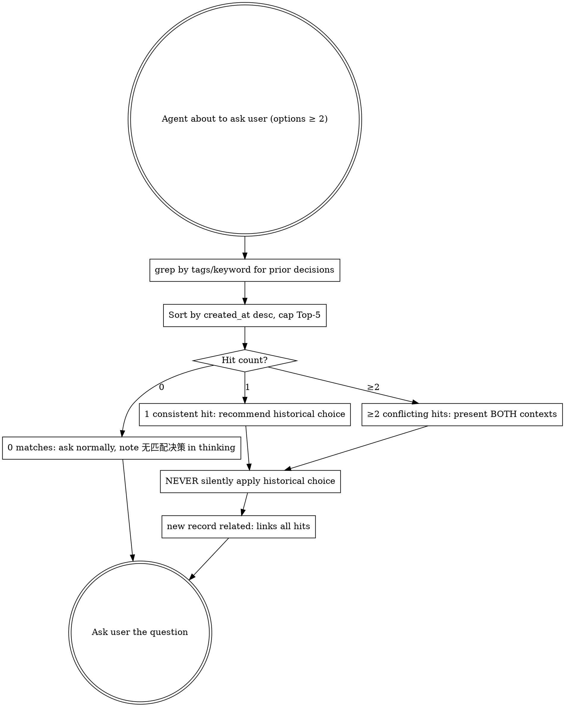

# AE Operations — 完整语义（第二层披露）

> 快路径见 SKILL.md；本文件按需读取：Step 0-6 全语义（含 dedup 三分支判例、证据定级 Step 3.5）、Query/社区记忆层/Pre-ask Query/Capture Decision/Reflect/Lifecycle，附录 Provenance。

## Operation: Capture (semi-auto)

Capture is **semi-automatic**: the agent drafts the experience, a human reviews it, then it becomes confirmed. D3 扩展（观察类分支）：`epistemic: observational`（事实可由提交物/命令输出直接复验）捕获即 `confirmed`。Never auto-store unreviewed **interpretive** drafts as confirmed.

### Step 0: 任务收尾双录（skill-uses＋reuses）先于 Capture

任务收尾固定顺序：**⓪ 技能使用双录**（skill-uses.md，见「技能使用记录」节）→ **① 复用回写**（本任务 Query/Pre-ask 命中且被用于产出 → 先向 `reuses.md` 追加行，见「复用回写」节）→ **② Capture**（dedup / 写草稿 / INDEX）。Capture 走到 dedup-skip（无可记）时，Step 0 依然独立执行——双录/回写与「本次有没有新经验可记」无关。

### 技能使用记录（skill-uses.md，Step 0 第一录）

任务收尾先向 `skill-uses.md` 追加行——**双录**：本任务**实际使用**的技能与**考虑过但未用**（considered-but-not-used）的技能各至少一行（机会分母 v0：机会行同样计数）。七列：

```
{YYYY-MM-DD} | {skill} | {task} | {trigger} | {sections} | {anchors} | {note}
```

- `sections`＝本任务实际读过的该技能文件（逗号分隔）——M 类段落修剪的引用源（m-predicates 政策卡）；
- `anchors` 必填且须引用**可解析工件**，三形态：dotfiles-sha（`<repo 相对路径>@<40hex>`，`ae.mjs verify-anchors` 走 `git cat-file -e` 解析）／foreign-repo sha（`foreign:<repo>#<branch>@<40hex>`，标 unverifiable-locally）／plain path（store/仓内相对或绝对路径，文件存在即可解析）；多 anchor 以 `;` 分隔；
- `note` 前缀记结果：`helped：…`／`counter：…`／`considered-but-not-used：…`；**禁 verdict 词**（verdict 由 `ae.mjs score` 按 e-thresholds 政策卡输出，记录面只记行为事实）；
- append-only：只追加，永不改写已有行；recorder 只记行为事实＋工件链接（recorder-charter 政策卡），`ae.mjs score`/`verify-anchors` 均只读。

### Step 1: Dedup check (grep-before-write)

Search existing experiences for the same title, tags, or root cause before writing anything:

```bash
grep -l "keyword" <store>/experiences/*.md
grep "^tags:.*<tag>" <store>/experiences/*.md
```

命中后三分支（硬性）：

- **逐字同事件**（同 project + 同根因 + 同表现/修法，无时间可区分的新发生）→ 更新该文件或跳过，不得新建重复文件；
- **同根因、有真实增量**——至少满足一项：不同项目/技术栈、不同修法、或明确可区分的新一次发生（新时间线/新表现）→ **照常新建记录**，`related:` 填命中旧 ID——佐证链：跨记录证据聚集的本地 proof-count，定期整理按 related 密度识别高频教训；E 级定级照旧只看本条，不回写旧记录；
- **存疑**（拿不准是否新发生）→ 按无增量处理（跳过），草稿呈报时向用户说明命中与存疑点。

**gap-fill 标签：**若本任务的 query 阶段标注过「无匹配经验」（个人库本地零命中，无论社区记忆层是否命中 advisory），本次 capture 的 tags 末尾追加值 `gap-fill`（是 tags 的一个值，不是新 frontmatter 键）。

### Step 2: Generate ID

Format: `YYYYMMDD-HHMMSS-<4hex>` (consistent with worktree timestamp naming).

```bash
date +%Y%m%d-%H%M%S-$(openssl rand -hex 2)
# or without openssl:
date +%Y%m%d-%H%M%S-$(printf '%04x' $RANDOM)
```

### Step 3: Create experience file

Write `experiences/{id}.md` with flat YAML frontmatter (see Schema; fill `summary:`) and the body template matching its `type`. Set `status: draft`.

**硬性（写文件时同批完成，缺一即不合格）：**
1. body 首段下方紧跟一行 `Evidence: E<n>（依据一句话）`（定级规则见 Step 3.5，级别仅限 E0-E4）；
2. `tags:` 末尾按 gap-fill 规则追加——若本任务 query 阶段标注过「无匹配经验」，必须加值 `gap-fill`（见 Step 1）。

Self-check before writing (0915 cycle caught 2 malformed IDs + 10 missing fields):

- ID matches `^[0-9]{8}-[0-9]{6}-[0-9a-f]{4}$` (hex only, exactly 4 chars — `rr5c`/`redock` style suffixes break INDEX grep-ability) and equals the filename stem
- Frontmatter carries ALL required keys: `id/created_at/type/project/summary/tags/status/schema_version` (decisions included — summary is their only quality gate under D3)
- `status: archived` 记录豁免 `summary`（lint.sh §2 语义；其余键仍全必填）——`ae.mjs validate` 同口径

### Step 3.5: 证据级别（一次性定级，永不回写）

body 首段下方写一行 `Evidence: E<n>（依据一句话）`。级别：E0=单次复现未验证 / E1=本地或 CI 复验通过 / E2=修复合并进主干或用户确认 / E3=跨项目复用一次 / E4=多次跨项目复用。仅新捕获适用——存量记录视为 ungraded，统计时排除，不做回填（raw 层不可变）。

### Step 4: Update INDEX.md

Append one line:

```
{id} | {created_at} | {type} | {project} | {summary} | {tags}
```

INDEX.md is a cache; it can always be rebuilt (see INDEX Rebuild below).

### Step 5: Human review

Present the draft to the user. The user sets `status: confirmed` or `status: rejected`. The agent never flips its own drafts to confirmed. 观察类分支（D3 扩展）：`epistemic: observational` 跳过本步——捕获即 `confirmed`（机器可验事实，复验即审核；详见 Capture Decision 节「D3 扩展」）。

### Step 6: Do NOT touch log.md

Unlike project-compound, there is no separate chronological log. The experience files themselves, ordered by `created_at`, ARE the log.

## Operation: Query



Example commands:

**L0 双语关键词（硬性）：**每次 grep 查询的关键词必须中英双写——技术专名保留原文，概念词给出中英两个词——分别执行两条 grep。语料侧不做双语化（2026-09-22 决策：正文中文+tags 英文维持现状）。

```bash
cd <store>
# zsh: if store may be empty, run `setopt NULL_GLOB` first (see Empty store note below)

# By type
grep -l "^type: debug" experiences/*.md

# By tag
grep -l "^tags:.*cmake" experiences/*.md

# By project
grep -l "^project: HXProjectTemplate" experiences/*.md

# Newest first, capped at Top-5
# ponytail: sort by created_at (date-only); same-day ties broken arbitrarily — add -k1,1r for filename-timestamp precision if needed
grep -l "^type: debug" experiences/*.md \
  | xargs grep -H "^created_at:" \
  | sort -t: -k3 -r \
  | head -5
```

**Top-5 cap (hard limit):** Never load more than 5 experience files into context, regardless of match count. Retrieval is a hint, not a dump. If more than 5 match, take the 5 newest.

### 复用回写（Reuse Write-back，任务收尾）

Query（或 Pre-ask）命中记录被读过、且出现在你的做法/结论里（引用它、按它调整方向、向用户呈现为先例）→ 收尾**必须**向 `reuses.md` 追加一行；读过但明确判定不适用 → 记 `not-helped`（同样是过期信号，喂给定期整理）；仅 grep 命中未读全文 → 不写。判定只看「是否用于产出」——与任务成败、是否复验、是否 capture 无关：

```
{YYYY-MM-DD} | {experience-id} | {project} | {harness} | helped|not-helped|counter | {一句话说明}
```

- append-only：只追加，永不改写已有行；不修改被引记录本身（E 级一次性定级不可回写，见 Step 3.5）
- `{harness}` 填当前 agent 运行时（`opencode`/`cursor`/`codex`…），跨 harness 复利靠此列计量
- 一条命中一行，多条命中各自成行；零命中不写
- `not-helped` 只记「任务域内候选落空」（读前有理由相信可能适用，读后落空）；宽泛兑底关键词捞到、仅为确认无关而读的记录不写，任务域零命中的事实表述（无匹配经验）也不因读过无关记录而改变
- 文件不存在时首次追加连同列头注释创建：`# date | id | project | harness | outcome | note`
- reuses.md 行是升华/Supersedes 提案可引用的 verbatim 证据——E3/E4 在 capture 时无法预知，复用证据只在此累积
- `counter`＝复用后出现相反证据（如命中某信念的 falsifies 条件、修法反噬）——计入 `ae.mjs score`（e-thresholds 卡 counter≥2 回滚）；append-only，存量行不改写，counter 仅约束新追加行

### 零命中回退：社区记忆层

个人库 0 命中（已按规则在 thinking 标注「无匹配经验」）→ 调用 `misakanet_search`（top 5）：
- 命中：按 advisory 呈现给用户/注入上下文（同 D5 跨项目纪律：永不静默应用；引用其 evidence_level 与域名 misakanet.org；技术栈差异显著时照旧标注「仅供参考」）
- MCP 不可用/出错/限流：视同普通零命中，降级继续任务，永不阻塞
- 仍无命中：thinking 标注「社区库亦无匹配」→ 本地 gap-fill 信号（见 Capture 触发规则）
- 禁止调用 `misakanet_write_lesson` / `misakanet_submit_intake`（向社区写入需用户单独授权，超出本 skill 范围）
- 可见性（硬性）：无论哪个分支（advisory 命中 / MCP 不可用降级 / 社区库无命中），都必须在最终回答中用一句话向用户说明回退尝试与结果（如「社区记忆层无匹配/MCP 不可用，已降级继续」），不得只在 thinking 中记录。

**Zero results:** If nothing matches, the agent MUST note "无匹配经验" in its thinking and proceed. Never silently skip the query step, and never fabricate experience. 零命中后也不为确认无关而通读无关记录（读面即检索面，Top-5 cap 同样约束零命中后的翻阅）。

**Empty store:** When no experience files exist yet, `experiences/*.md` matches nothing. In bash, grep reports "No such file" and exits (handle with `2>/dev/null`); in zsh, the unmatched glob aborts before grep runs (use `setopt NULL_GLOB` or guard with `ls experiences/*.md 2>/dev/null`). An empty result is the "no prior experience" case — note "无匹配经验" and proceed.

## Operation: Pre-ask Query

Pre-ask Query 专门服务 `type: decision`：在 agent 向用户抛出一个 ≥2 候选的单选问题**之前**，先查历史同类决策，避免重复打扰用户、复用既有偏好。与任务级 `## Operation: Query`（任务开始前查经验）的区别：Pre-ask Query 是**每次提问前**的细粒度检索，命中后直接影响问题措辞。



**命中分级行为（硬性，逐条对照）：**

| 命中数 | 行为 |
|--------|------|
| 0 matches | 照常提问，thinking 内标注「无匹配决策」，不编造历史；新记录 `related:` 留空 |
| 1 consistent match | 在问题中**显式推荐**历史选择，标注「上次在 \<project\> 选过 X，理由 Y」，用户可一键覆盖 |
| ≥2 conflicting matches | 同时呈现**双方**语境，请用户解释当前偏好；新记录 `related:` 链接全部命中 |

**铁律：NEVER silently apply historical choice.** 即便只有 1 条强一致命中，也必须在问题里明示「这是历史偏好」，由用户确认或覆盖——禁止 agent 自作主张替用户决定。

**跨项目命中（D5）：** agent MUST 读命中记录的 `project:` 与 `## Context`；若技术栈差异显著 → 呈现时标注「仅供参考，未必适用」，绝不当指令套用。匹配仅靠现有 `tags`，不新增匹配字段。

**采纳即回写：**用户按历史命中的推荐做出选择（或以它为语境调整）→ 任务收尾同样按「复用回写」追加 `helped` 行。

**示例命令（仅筛 decision 类型）：**

```bash
cd <store>
# 仅看历史决策，按时间倒序取 Top-5
grep -l "^type: decision" experiences/*.md \
  | xargs grep -H "^created_at:" \
  | sort -t: -k3 -r \
  | head -5
```

## Operation: Capture Decision

与任务级 `## Operation: Capture`（半自动、任务完成后生成 draft、待人类审核）不同：**Capture Decision 是即时的、逐决策的**——用户一选定，agent 立刻落盘一条 `type: decision` 记录，不等任务结束。

**触发条件（同时满足）：**

1. agent 调用提问工具，且 `options.length ≥ 2`；
2. 用户已给出选择（含「选了列表外方案」的情形）。

满足即 capture，每条决策独立成文件，不合并进任务级 summary。

### Step 1: 触发检测

监听自身的提问行为：只要抛给用户的问题含 ≥2 个并列候选、且用户做出了选择，就触发。确认性 Y/N 提问（无真正候选分歧）**不触发**。

### Step 2: 套用 Pre-ask Query 的命中（若有）

若提问前跑过 Pre-ask Query：新记录的 `related:` 字段填入全部命中 ID（0 命中则留空）。链深 ≤ 3 跳，只链直接前驱。

### Step 3: 生成 ID（同 Capture）

```bash
date +%Y%m%d-%H%M%S-$(openssl rand -hex 2)
```

### Step 4: 写文件，套 `type: decision` 模板

按交付物 3 的模板填字段。要点：

- **status 直接写 `confirmed`**：用户刚刚亲手选择 = 已审核（D3）。不走 draft 等待流程，不违反 ECC（ECC 管的是语义层自动升华，不是经验层 status）。
- **Rationale 带 `[inferred]`**：agent 推断的理由一律标 `[inferred]`；用户事后纠正 → 改 `[confirmed YYYY-MM-DD]`。推断与确认分两行，不混写。
- **User-Proposed Alternative（A5）**：用户选了 options 之外方案 → 加 `## User-Proposed Alternative` 小节 + `tags:` 追加 `user-proposed`。
- **敏感决策（A7）**：body 只写决策模式，不写密钥；`tags:` 追加 `sensitive`，跨项目呈现降级。
- **summary 必填**：决策点+选中选项+关键理由，一行；选中选项名即具体标识。decision 记录跳过 draft 人工审核（D3），此规则是 summary 质量的唯一闸门

### D3 扩展：观察类捕获即 confirmed（2026-10-10）

D3 的「用户刚刚亲手选择 = 已审核」推广到机器可验事实：`epistemic: observational`（＝记录的事实可由提交物/命令输出直接复验——重跑命令、查看提交物即得同果）满足即视同已审核。任务级 Capture 与 Capture Decision 同样适用：status 直接写 `confirmed`，不走 draft 等待流程。

- **边界定义**：观察类 = 机器可验事实（命令退出码/输出、提交物中的逐字内容）；解释类（`epistemic: interpretive`）= 推断、权衡、复盘归因——照旧 `draft` 人工审，agent 永不自翻。键缺省 = 未分型，存量记录不回填。
- **与 2026-09-09 失败先例的和解**：「把 draft 当 confirmed 用」禁的是未经确认的**解释**被当结论引用；观察类 = 机器可验事实，非未验证推断——复验即审核，两者不冲突。

### Step 5: 更新 INDEX.md

追加一行（与任务级 Capture 同格式，type 列填 `decision`）：

```
{id} | {created_at} | decision | {project} | {summary} | {tags}
```

### Step 6: 不另起 log

经验文件本身按 `created_at` 排序即为日志，与任务级 Capture 一致，无独立 log.md。

### Capture Belief（信念捕获流，#0025）

Capture 的特例：把跨任务规律蒸馏成**信念记录**（schema 见 `references/templates.md`「epistemic: belief」）。硬性：

- 形态＝`type: other` ＋ `epistemic: belief` ＋ `status: draft`——**永不直接 confirmed**（信念非事件，转正只经证据阈值：`ae.mjs score` 按 e-thresholds 卡 helped≥3 转正／counter≥2 回滚）；
- `holds:`（适用边界）与 `falsifies:`（证伪条件）必填（validate 强制）；
- body 首段下一行 `Evidence: E0（draft 信念蒸馏）`；正文含逐字引用（源记录 id＋原文短引）；
- Wave 2 聚类豁免：belief 记录不参与重复聚类与 merge 候选（GROOMING）。

### 矛盾检测（conflict 协议）

新观察（capture／复用回写）落库前，扫描既有 belief 记录的 `falsifies:` 条件：新观察**命中某信念的证伪条件** → 生成 conflict 标记提案——在两条记录的 **frontmatter** 各加 `conflict: <对方id>`（双向标记），**禁改任何 body**。解歧＝后续任务的使用结果（reuses/skill-uses 新增行）；人仅平局（双向均无新证据 30 天 → 呈平局卡）。E 事件机械分级（GROOMING 夜波）：命中 holds 语境且结果 helped → E 级上探；命中 falsifies 且结果 counter → E 级降探＋conflict 提案。

## Operation: Reflect（跨记录模式挖掘）

单条经验看不出的模式——同一 root cause 换了几个项目复发、同类决策总同方向、从未被 query 命中的暗聚集——只在跨记录聚合时浮现。Reflect 是有界的多轮 grep 循环（Hindsight reflect 的 grep 版移植），不是一次检索。

**触发**：手动定期整理时可选执行；夜间治理按 GROOMING.md Wave 5.5 条件触发（周日，或距上次 reflect ≥7 天且新增 confirmed ≥10）。

**机制（硬性上限，逐条对照）：**

1. **选域**：一个 `type` 或一个 tag 域内的 confirmed 记录，≥5 条才值得跑；不足则跳过。
2. **≤5 轮检索**：每轮一条 grep（L0 中英双写照旧）→ 读命中全文 → **由本轮发现决定下一轮关键词**（换词重查是循环的本质，不是重复同一查询）；连续一轮无新命中即提前终止。
3. **通读 ≤20 条**：每轮命中按 created_at 取 Top-5，全程累计通读上限 20 条文件——检索是提示不是倾倒。
4. **先取证后归纳**：每个模式必须附**逐字可 grep 的证据引用**（≥2 条不同 project 的记录），转述不算。
5. **产出** `reviews/reflect-<YYYYMMDD>.md`：模式（一句话）+ 证据引用（id + 逐字片段）+ 升华提案（指向 project-compound ingest，**不自动执行**，ECC 边界）。报告文件即操作产出：**直接写盘，无需向用户请示**（store 只读、报告仅入 reviews/，无副作用；夜间 groom 无人在场，请示即丢报告）。
6. **禁区**：只读 `experiences/`；不改任何经验文件与 INDEX；提案零落库，全部待人工。

与 Wave 5（升华候选检测）的分工：Wave 5 逐条标注跨项目可复用；Reflect 聚合跨记录模式。两者产出都只进报告。

## Operation: Lifecycle

```
draft --(human approves)--> confirmed
draft --(human rejects)---> rejected
draft --(cold-draft 提案人工批准→Wave6.5)--> archived
confirmed --(stale/superseded)--> archived
```

| Status | Meaning | Queryable? |
|--------|---------|------------|
| draft | Agent-written, awaiting human review | Yes, but flag as unconfirmed |
| confirmed | Human-reviewed 或观察类机器可验（`epistemic: observational`），trusted | Yes |
| archived | Was valid, now stale or superseded | Exclude by default |
| rejected | Human rejected, kept for audit | Exclude by default |

**Passive review (CARDS):** draft 进入人工呈批队列的条件＝其 id 在 reuses.md 第 2 列出现（被实际复用过才值得人看；命中信号只认 reuses.md 第 2 列，不建 hits.md；**信念记录除外**——走信念证据晋升卡轨道）。`ae.mjs cards` 只读生成五类呈批卡（canary 转全量／命中 draft 确认／sublime-* 升华提案 verdict: pending／promoted ≥14 天无 outcome 欠账，至多 5 张旧者优先／信念证据晋升：`epistemic: belief` 且 body `Evidence: E3+`——跨项目复用达成，待人工核对后转正），stdout-only 不写 store，调用方重定向落盘；输出确定性（两跑逐字节一致），events 源＝`AE_EVENTS_PATH` > `<repo-root>/.skill-evolution/events.md`。draft→archived 仅经 cold-draft 提案人工 verdict 批准（Wave 6.5 机械执行）后发生。

**reuses.md 勘误规则:** 既有畸形行（如第 1 列非日期）永不改写——修复方式一律为文末追加勘误行（正确六列格式＋行尾 `  # 勘误：替代上方畸形行`），并配 lint 第 1 列日期格式防线提示；append-only 纪律优先于表面整洁。
**Promotion to semantic memory:** A confirmed experience with general, project-wide applicability can be promoted into `./docs/agents/knowledge/` via `project-compound ingest`. Promotion is a manual human decision, never automatic. Episodic record stays; the semantic wiki gets the distilled conclusion. Failure-oriented experiences (debug pitfalls, rejected approaches, recurring root causes) promote into the semantic layer's **Failed Approaches** entries (project-compound module template); success strategies into **Strategies**. Failure lessons are first-class knowledge, equal to successes.

**Evidence baseline (proposals need evidence, not impressions):** proposing a promotion or flipping a `Supersedes-candidate:` requires (a) reading the FULL target experience file — the INDEX row / `summary` is a retrieval entry, not evidence; (b) citing raw evidence in the ingest proposal as verbatim, greppable quotes (commit hash / command output / line refs) — paraphrase is not evidence. Supersession flips additionally require evidence from BOTH the new and the superseded record. No evidence, no proposal.

### 定期整理（Periodic Review）

夜间 grooming（若部署方配置了自动化，如 cron 驱动）协议见 `<store>/GROOMING.md`——存在时**以 GROOMING.md 为准**，本节不重复其内容。

人工介入点（唯一保留的手动路径）：
- 每月一次人工抽检 groom 报告（`reviews/`），重点看 Wave 4 draft 审查 verdict 与 Wave 5 升华候选——status 翻转与 ingest 仍是人工专属
- 技术栈替换后（库/框架大换），手动触发一次全库扫过期（grep 相关 tags → 逐条人工判 archived）
```bash
cd <store>
# 手动扫过期：按 tags 定位技术域，人工逐条判断
grep -l "^tags:.*<tech>" experiences/*.md
```


---

## Provenance

> Rule provenance: key rules in this skill and the knowledge they came from. Read the source before changing a rule.

| Rule | Source |
|------|--------|
| Drafts never auto-promote to confirmed (semi-auto capture) | knowledge: agent-guidelines decision "经验记忆：半自动捕获机制 (2026-08-07)" |
| No automatic batch ingest (ECC ban) | knowledge: agent-guidelines decision "ECC (Everything Claude Code) 能力评估：不引入 (2026-05-26)" |
| decision-type captures confirmed immediately; rationale tagged `[inferred]` | design decision D3, this file's Capture Decision section |
| Cross-project hits are advisory only (never silent apply) | design decision D5, this file's Pre-ask Query section |
| Failure experiences promote to Failed Approaches | WikiSkill closed-loop adoption (arXiv:2608.27454 §3.1), recorded in knowledge: skill-system |
| summary frontmatter key + INDEX col 5 swap | WikiSkill one-line index, marked CRITICAL (arXiv:2608.27454); knowledge: experience-memory 2026-09-11 |
| Promotion/supersession evidence baseline | WikiSkill grounding minimum (read ≥4 traces before proposing), adapted human-gated (arXiv:2608.27454); knowledge: experience-memory 2026-09-11 |
| 社区记忆层零命中回退（advisory only） | MisakaNet 借鉴 (2026-09-22)，knowledge: experience-memory ingest |
| Evidence E0-E4 一次性定级、永不回写 | MisakaNet 借鉴 (2026-09-22)，按 raw 不可变裁剪 |
| gap-fill 标签 + 定期整理自证指标 | MisakaNet 借鉴 (2026-09-22)，no_match→intake 信号本地化 |
| 复用回写 reuses.md + 定期整理复利指标 | agent-beacon 借鉴 (2026-09-23)，「Evaluate what worked」本地化；E 级不可变，复用证据独立 append-only 累积 |
| 可选 harness: 字段 + 平面文件跨 harness 复用 | agent-beacon 借鉴 (2026-09-23)，跨 harness 复利最小实现（零基建，grep 直读） |
| Reflect 有界多轮循环 + GROOMING Wave 5.5 触发 | Hindsight 借鉴 (2026-09-26)，agentic loop 的 grep 裁剪；knowledge: experience-memory 2026-09-26 ingest |
| 信念生命周期（belief schema＋holds/falsifies＋conflict 协议＋五类卡） | verdict-auth W2 候选 #0025-ae-belief-lifecycle（.omo/plans/verdict-auth.md T5），2026-10-11 晋升激活 |
| skill-uses 双录＋reuses counter 枚举＋score/verify-anchors | verdict-auth W3 候选 #0026-ae-recorder-scorer（.omo/plans/verdict-auth.md T7），2026-10-11 晋升激活 |

